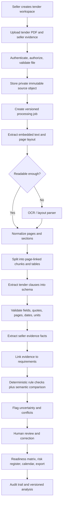

# GeM Tender Copilot — Technical Architecture

This document describes a realistic architecture for an evidence-first tender-review assistant. It is a proposed design, not an implemented system.

## 1. Guiding Architecture Rules

1. Preserve the source document and its version; never rewrite the uploaded original.
2. Treat OCR and AI extraction as fallible. Preserve page-level source text and quality signals.
3. Use AI for language-heavy tasks such as classifying clauses, extracting structured fields, and proposing semantic matches.
4. Use deterministic code for comparisons that can be represented as rules: amount thresholds, project counts, dates, mandatory fields, and expiry windows.
5. Require a source citation for material findings.
6. Let users correct extracted facts and record review decisions.
7. Isolate tenants and files; prevent uploaded content from becoming instructions to the extraction model.
8. Record the exact inputs, prompt/schema, model/provider version, rules version, and output for reproducibility.
9. Do not depend on scraping or undocumented GeM integration in the MVP.
10. Use abstractions so a provider can be changed without rebuilding the domain logic.

## 2. Proposed Stack

A practical starting stack could be:

| Layer | Starting option | Reason / caveat |
|---|---|---|
| Web frontend | React + TypeScript | Interactive matrices, document review, upload progress, and typed API contracts |
| API | Python + FastAPI | Strong PDF/data/AI ecosystem and easy separation of HTTP endpoints from workers |
| Database | PostgreSQL | Relational links between tenders, requirements, evidence, reviews, versions, and findings |
| Object storage | Private S3-compatible or GCS bucket | Store original PDFs and report exports without making them public |
| Background tasks | Celery/RQ with Redis, or managed queue/workers | OCR and model calls can take longer than a normal request |
| PDF text | PyMuPDF and/or pdfplumber after license/version review | Extract text while preserving page metadata; table quality needs testing |
| OCR/layout | Local OCR or managed document-understanding provider | Choose after testing accuracy, latency, languages, data policy, and cost |
| AI extraction | Provider abstraction returning schema-validated JSON | Keep model dependence separate from the requirement and evidence domain model |
| Rule engine | Normal Python modules with explicit tests and versioning | Transparent comparisons and stable behavior |
| Authentication | A managed identity provider or mature application auth library | Avoid inventing password security and tenant isolation |
| Report export | HTML-to-PDF plus CSV/XLSX export where needed | Keep tables and source references usable for a human reviewer |
| Observability | Structured logs, metrics, error tracking, audit events | Diagnose failures and measure accuracy/cost per stage |

Do not add Kubernetes or complex microservices before there is workload evidence that they are needed. A modular monolith plus a background worker is likely enough for the first pilot.

## 3. End-to-End Data Flow



This is the conceptual workflow. Implementation can split it into fewer or more services depending on hosting constraints.

## 4. Component Responsibilities

### 4.1 Upload API
- Authenticates the requester and checks workspace membership.
- Checks size, allowed file types, actual file signature where practical, page count, and content safety.
- Uses application-generated object keys rather than trusting user-supplied filenames as paths.
- Writes the file into private storage and creates a document/version record.
- Schedules asynchronous work and returns a job ID.
- Does not parse a large PDF synchronously inside the web request.

### 4.2 Document worker
- Computes a checksum for deduplication and audit.
- Uses embedded text extraction first where possible.
- Applies OCR to scanned or image-based pages.
- Preserves page boundaries, text blocks, tables, reading order, and OCR quality signals where available.
- Detects encrypted, empty, corrupt, oversized, or low-quality pages.
- Stores normalized page text separately from the original binary.
- Marks pages or the document as failed/partial when content cannot be extracted reliably.

Google Document AI is one documented example of a service that extracts text/layout and turns document content into structured data, including key-value pairs and tables. It is not mandatory: benchmark a local or alternative provider against representative tender PDFs before deciding. See [Document AI overview](https://docs.cloud.google.com/document-ai/docs/overview) and [supported file types/quality guidance](https://docs.cloud.google.com/document-ai/docs/file-types).

### 4.3 Layout, segmentation, and clause detection
Create blocks such as:
- Main clauses and subclauses.
- Eligibility and qualification sections.
- Technical specification tables.
- Annexures and required forms.
- Commercial/security terms.
- Key date schedules.
- Corrigendum / amendment sections.

Chunk by page and semantic structure rather than arbitrary character length alone. Do not discard page-number information or table headings during chunking. Keep a link from every chunk to its source document and page.

### 4.4 Extraction service
Use model output only through a strict schema. For each requirement, collect at least:
- Exact or short source quotation.
- Source document/version and page.
- Clause identifier / heading when extractable.
- Requirement category.
- Requirement type: numeric, date, document, technical, declaration, conditional, etc.
- Threshold, unit, currency, period, count, and comparator where present.
- Conditions and exceptions in nearby text.
- Required evidence type.
- Severity candidate and confidence.
- Uncertainty/ambiguity explanation.

The model must be allowed to return "unknown / ambiguous / needs review." Do not force a guess simply to fill a required field.

### 4.5 Evidence extraction service
From seller documents, extract candidate facts such as:
- Legal entity name and identifiers.
- Certificate type, number, issue/expiry date, issuer, and entity it belongs to.
- Financial years, turnover amount, currency, and source evidence.
- Project/order value, buyer, date, scope, completion/acceptance status.
- Product model, parameters, standards, warranty, and datasheet version.
- OEM/manufacturer relationship and authorization validity.
- Signatures or required forms, where detectable.

A detected value is not automatically verified as authentic. Record evidence provenance, extraction confidence, and review status.

### 4.6 Requirement/evidence matcher
Use two layers:

**Deterministic matching**
- Compare normalized amounts, dates, project counts, and explicitly structured conditions.
- Check year coverage and whether evidence belongs to the correct legal entity.
- Detect expiry and conflicting values.
- Apply a policy exception only when its complete conditions are represented in reviewed rules and verified seller facts.

**Semantic assistance**
- Propose whether a project description appears similar to the tender's requested work.
- Suggest which evidence documents might support an unstructured requirement.
- Explain likely technical matches or mismatches based on quoted parameters.

Semantic similarity must never silently override an explicit numeric threshold, missing statutory document, non-equivalent unit, unresolved condition, or buyer-defined clause. If evidence is ambiguous, return a review state.

### 4.7 Rule engine
Represent each check as:
- Stable rule ID and version.
- Source requirement ID.
- Required fact(s).
- Comparison method.
- Result.
- Explanation.
- Evidence used.
- Whether human approval is required.

Example: "At least five completed comparable projects above ₹50 lakh each" requires a validated project list, completed status, comparable-scope review, individual project values, and currency normalization. Three discovered documents are not by themselves proof the company has only three projects; report "three evidence items found, threshold requires five; additional evidence may be missing" unless the seller confirms the inventory is complete.

### 4.8 Corrigendum/version service
- Treat each uploaded version as immutable.
- Capture document date, upload date, published date if known, and relationship to the base bid.
- Diff normalized sections and tables; flag changed text and dates.
- Link each changed clause to affected requirement IDs and prior analysis results.
- Mark the report stale when a newer version is uploaded.
- Never assume all amendments have been uploaded; show a "latest known version" label and a verification reminder.
- Preserve before/after text so the seller can review the actual change.

### 4.9 Report service
Provide:
- Summary with counts and major blockers.
- Evidence-backed requirement matrix.
- Document checklist.
- Technical compliance matrix.
- Risk register and action owner/status.
- Timeline with source and time-zone confidence.
- Corrigendum change log.
- Export timestamp, original document/version IDs, analysis ID, model/provider/rule-set versions, and disclaimers.

## 5. Suggested API Boundaries

These are candidate endpoint shapes, not a final API contract:

| Endpoint | Purpose |
|---|---|
| `POST /workspaces` | Create a workspace |
| `POST /tenders` | Create a tender review |
| `POST /tenders/{id}/documents` | Request a secure upload |
| `POST /tenders/{id}/analyze` | Queue or retry analysis |
| `GET /jobs/{job_id}` | Check processing status |
| `GET /tenders/{id}/requirements` | List source-linked requirements |
| `GET /tenders/{id}/report` | Fetch report state/data |
| `PATCH /requirements/{id}/review` | Record a human review/correction |
| `POST /tenders/{id}/corrigenda` | Add an amendment version |
| `GET /tenders/{id}/changes` | Compare document versions |
| `POST /tenders/{id}/exports` | Queue report export |
| `DELETE /documents/{id}` | Delete a document and trigger configured retention/deletion workflow |

All endpoints require authorization appropriate to the workspace. Avoid creating publicly accessible file URLs that remain valid indefinitely.

## 6. Analysis Job State Machine

Use explicit job states so the interface can explain what is happening:

```text
uploaded
  -> validating
  -> queued
  -> extracting_text
  -> OCR_if_required
  -> segmenting
  -> extracting_requirements
  -> validating_evidence
  -> evaluating_rules
  -> needs_review / completed
```

Terminal/error states might include `failed_validation`, `failed_processing`, and `cancelled`. Save failure stage, safe error code, retryability, and retry count. Keep internal stack traces out of user-facing messages.

## 7. Operational and Cost Design

- OCR and LLM use can scale with PDF page count, page complexity, repeated analyses, and selected model.
- Track per-stage duration and cost, document/page count, retry count, and token/page usage where the provider reports it.
- Cache deterministic extraction by document checksum when permitted and safe, but re-check tenant permissions and provider retention rules.
- Avoid resending the entire tender to the model for every UI action; store validated extraction results and process only affected sections when possible.
- Use queue concurrency and per-workspace quotas to prevent a single upload from exhausting capacity.
- Add budget alerts, but remember they are notifications rather than a guaranteed hard spending cap.
- Keep a provider adapter interface for OCR/LLM so a pricing, latency, or data-policy change does not require rewriting the domain logic.

## 8. Build Order

1. Implement secure upload and file/document version records.
2. Parse a text-based PDF and preserve source page mappings.
3. Add OCR fallback and per-page quality warnings.
4. Build the tender requirement schema and validate every source citation.
5. Display extracted requirements without eligibility scoring.
6. Add seller evidence and manual evidence linking.
7. Add a small deterministic rule engine with explicit tests.
8. Produce a report, then support version/corrigendum comparisons.
9. Measure against labelled documents before claiming the report is dependable.
